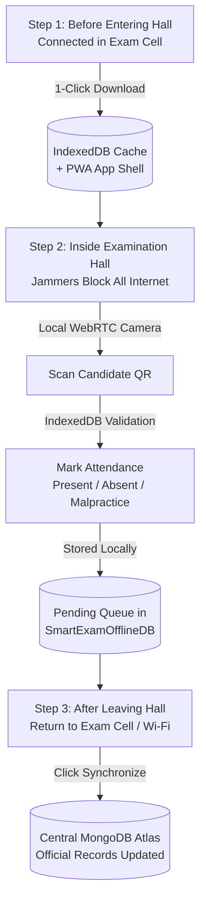

# 🛡️ Offline Examination System Architecture & Jammer Resilience Guide

This document explains the technical architecture, implementation, and standard operating procedures (SOP) for operating the **Smart Examination Management System** in environments equipped with **Mobile Network / Signal Jammers**.

---

## 1. The Core Problem: Offline Data vs. Offline Website

When mobile network jammers or radio-frequency (RF) suppressors are activated inside an examination hall, they disrupt cellular connectivity (GSM, 3G, 4G LTE, 5G) and frequently jam wireless Wi-Fi bands (2.4 GHz and 5 GHz).

> **Crucial Architectural Concept:**  
> **Offline data and an offline website are two completely different things.**  
> Downloading student records to a browser database (IndexedDB) is useless if the website itself cannot boot. Without an offline application shell, opening a new tab or refreshing the page forces the browser to request `index.html` and JavaScript/CSS bundles from the web server. The browser immediately crashes with `ERR_INTERNET_DISCONNECTED`.

To guarantee continuous operation under active jammers, this system implements **Three Resilient Pillars**:
1. **Pillar A: Progressive Web App (PWA)** to cache the application shell (HTML, CSS, JS, fonts, icons).
2. **Pillar B: Browser IndexedDB** to store student rosters, seat allocations, candidate photos, and the offline attendance queue.
3. **Pillar C: Campus Local LAN / Intranet Option** to host the server locally on a college machine with Ethernet or an isolated Wi-Fi router.

---

## 2. Pillar A: Progressive Web App (PWA) Implementation

### Application Shell Caching (`client/public/sw.js`)
The Progressive Web App registers a Service Worker that intercepts browser network requests:
- **Pre-Caching (`install` event):** Immediately saves `/index.html`, `/manifest.json`, `/pwa-icon.svg`, and `/favicon.svg` into CacheStorage (`smart-exam-pwa-v1`).
- **Navigation Interception (`mode === 'navigate'`):** When an invigilator opens the browser URL or refreshes in a jammed room, the Service Worker intercepts the request. If the network times out or fails (due to jammers), it serves the pre-cached `index.html` application shell in 0 milliseconds.
- **Static Asset Caching (Cache-First with Stale-While-Revalidate):** JavaScript bundles, CSS stylesheets, and icons are cached locally. If present in CacheStorage, they load instantaneously without touching any remote server.

### Web App Manifest (`client/public/manifest.json`)
Allows invigilators to install the application as a standalone desktop or mobile app (PWA) with custom icons, full-screen standalone mode, and instant desktop launcher shortcuts.

---

## 3. Pillar B: Local Data Persistence via IndexedDB

### Database Schema (`SmartExamOfflineDB` v2)
The client includes a dedicated IndexedDB database manager in `client/src/utils/offlineStorage.js`:

| Object Store | Key Path | Description |
| :--- | :--- | :--- |
| `offline_rosters` | `key` (`examId_hallId`) | Complete student roster for the assigned exam & hall, including candidate PRN, student name, seat coordinates (row/col), and registered photo. |
| `pending_attendance` | `id` (Auto-increment) | Indexed on `['examId', 'studentId']`. Stores locally validated attendance stamps awaiting server sync. |
| `exams_cache` | `_id` | Cached examination timetables, subject codes, and session timings. |
| `halls_cache` | `_id` | Cached hall capacities, building names, and floor numbers. |
| `offline_meta` | `key` | Metadata recording when the offline package was downloaded, assigned invigilator details, and preparation status. |

### How Hardware & Web Technologies Work 100% Offline
- **Device Camera Scanner:** Runs via WebRTC `navigator.mediaDevices.getUserMedia()`, accessing the local camera hardware sensor entirely on-device without internet.
- **QR Decoding:** JavaScript-based client-side decoding (`Html5Qrcode` / `jsqr`) processes video frames locally in the browser memory.
- **Live In-Hall Updating:** When an invigilator records attendance (Present, Absent, Malpractice), `updateStudentAttendanceInCachedRoster()` updates the local roster in real-time, keeping live counters (e.g., 28/30 Present) accurate without a server.

---

## 4. Pillar C: Campus Local LAN & Local Server Option

If the college prefers real-time server synchronization across the building without relying on public internet:

### 1. Zero WAN Requirement
The Express backend and MongoDB database can be hosted on a single computer (e.g., a laptop or exam cell desktop) inside the building.

### 2. Host Binding (`0.0.0.0`)
In `server/server.js`, the server listens on all network interfaces:
```javascript
app.listen(PORT, "0.0.0.0", () => {
    // Accessible across the entire college LAN / Wi-Fi
});
```
The server automatically detects and prints the machine's local IPv4 addresses (e.g., `http://192.168.1.105:5000`).

### 3. Wired Ethernet Immunity to RF Jammers
> [!TIP]
> **Radio-Frequency (RF) Jammers disrupt electromagnetic airwaves (cellular and Wi-Fi signals). However, physical wired Ethernet cables (Cat5e / Cat6) are shielded and 100% immune to wireless jammers.**
>
> In high-security exam centers where aggressive multi-band jammers are deployed, exam halls wired with Ethernet switches allow computers or laptops to communicate with the central college server with zero interference.

### 4. Single-Port Integrated Production Serving
When `client/dist` is built, Express automatically serves both the React PWA frontend and the API on a single port (`http://<SERVER_IP>:5000`), removing the need for a separate frontend server.

---

## 5. Standard Operating Procedure (SOP) for Invigilators



### Phase 1: Pre-Exam Preparation (In Exam Control Cell — Connected)
1. Open the website on your laptop, tablet, or smartphone.
2. Log in with your Invigilator credentials.
3. Navigate to **Offline Sync (IndexedDB)**.
4. Select the active examination subject and your assigned hall.
5. Click **Download Full Exam Package (1-Click)**.
   - The browser verifies the PWA App Shell is cached.
   - Student rosters, seating allocations, and candidate details are stored in IndexedDB.
6. *(Optional)* Click **Install PWA to Device** to add the Smart Examination icon directly to your home screen or desktop.

### Phase 2: In-Hall Examination Proctoring (Inside Hall — Jammers Active)
1. Open the Smart Examination PWA.
2. Navigate to **QR Camera Scan**.
3. Point the device camera at the candidate's Hall Ticket QR code or Hall Entry Pass.
4. The system validates:
   - Candidate enrolled subject matches the current examination paper.
   - Candidate assigned hall and seat coordinate.
   - Candidate identity against their registered photograph.
5. Click **Mark Present**, **Mark Absent**, or **Flag Malpractice**.
   - Attendance is stamped and saved into the local IndexedDB queue.
   - The live in-hall candidate counter updates immediately.

### Phase 3: Post-Exam Cloud Synchronization (Exiting Hall — Reconnected)
1. Once outside the hall or upon returning to the Examination Cell, connect to the campus network.
2. Navigate to **Offline Sync (IndexedDB)**.
3. Review the **Pending Records Queue**.
4. Click **Synchronize Records to Central Server**.
5. The records are pushed to `POST /api/attendance/sync-offline`, verified by the server, and written to MongoDB with official offline audit stamps.

---

## 6. CLI Quick Reference for College IT Administrators

### Running the System on a Local College Machine (Offline LAN)

```bash
# 1. Build the production React PWA client
cd client
npm run build

# 2. Launch the Central Campus Server (accessible to all LAN devices)
cd ../server
node server.js
```

### Access URLs for Invigilator Devices
- **Host Machine:** `http://localhost:5000`
- **Campus Intranet (Wi-Fi / Ethernet):** `http://<SERVER_LAN_IP>:5000` (e.g., `http://192.168.1.50:5000`)
