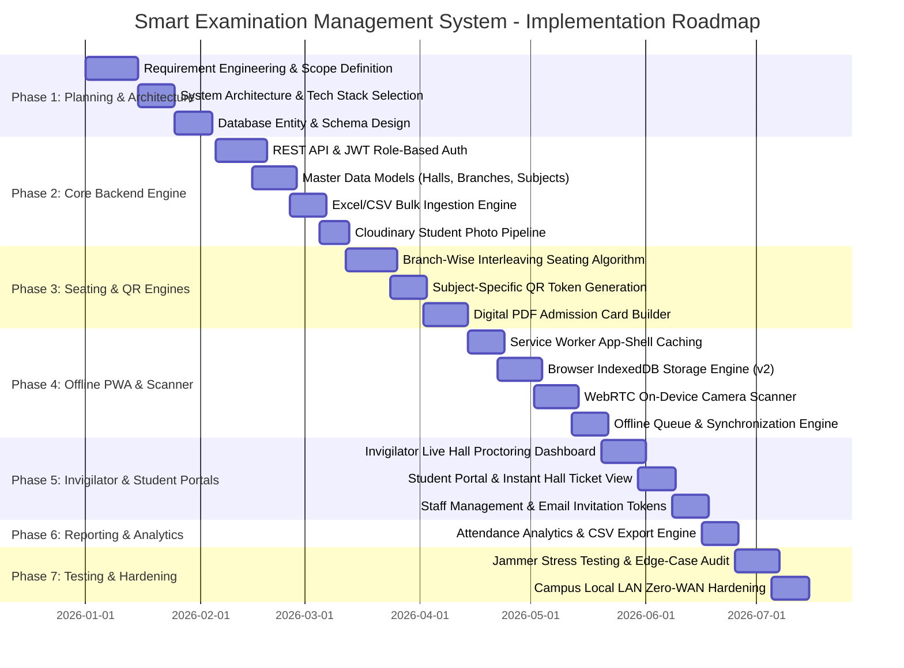
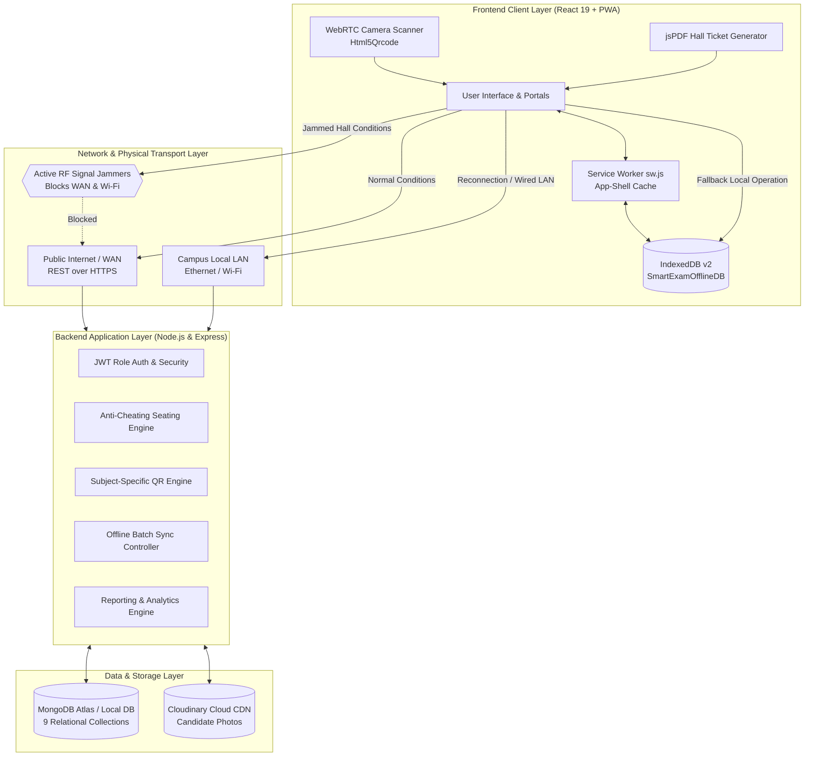
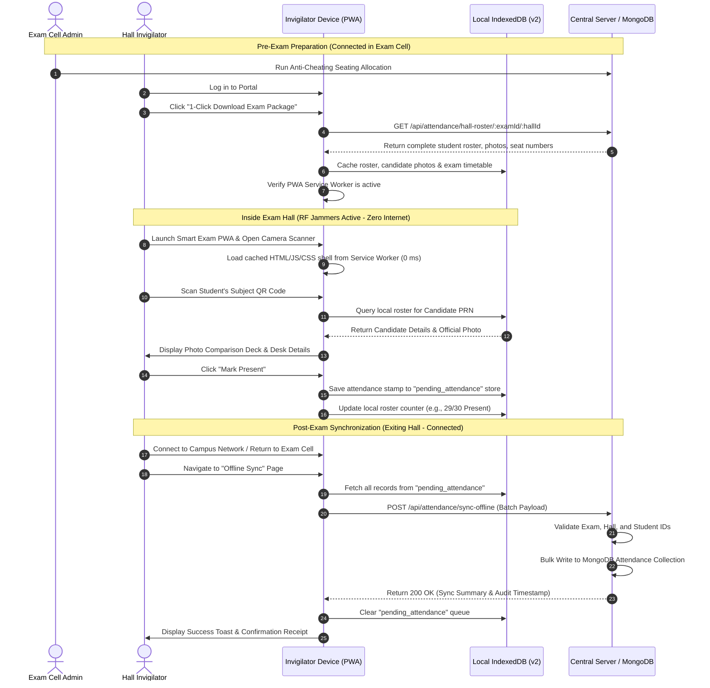
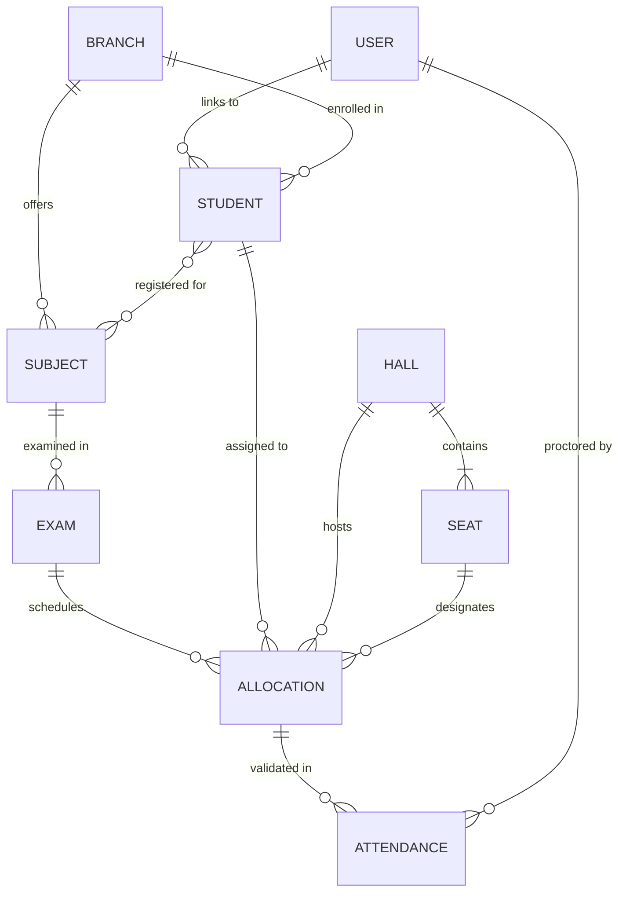
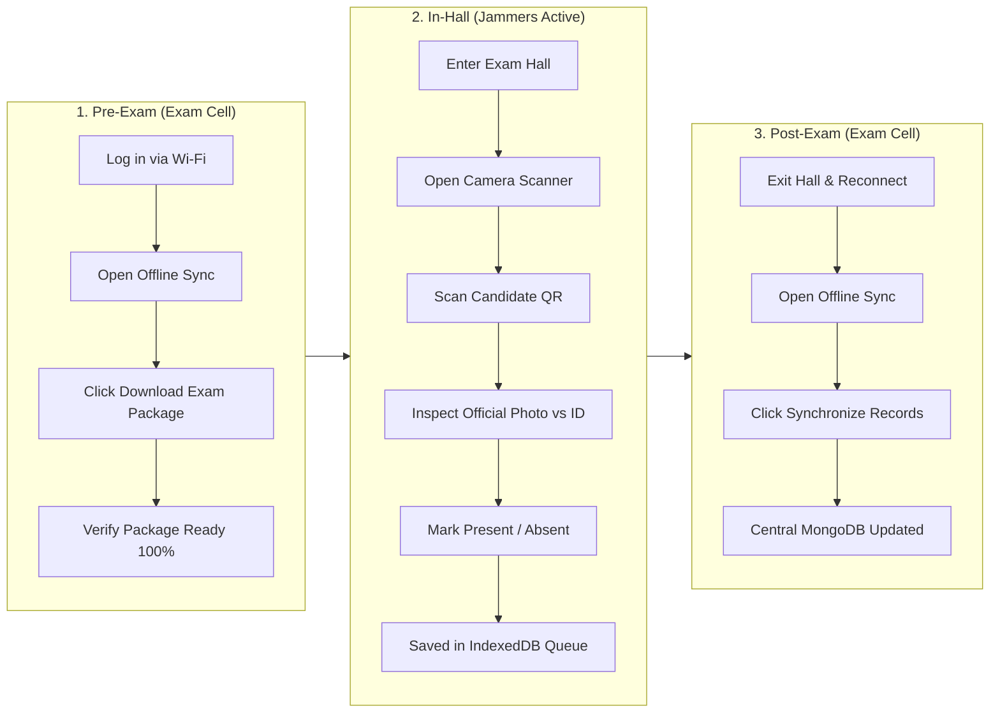

# Smart Examination Management System
## QR-Based Student Verification & Automated Anti-Cheating Seating Allocation

### Complete Implementation Plan & Technical Engineering Documentation

---

**Academic Programme:** Bachelor of Technology (B.Tech.) in Computer Science & Engineering  
**Institute:** Government College of Engineering, Amravati (GCOEA)  
**Project Guide:** Dr. Naresh G. Gadge  
**Authors & Development Team:**
1. **Harshali Villhekar** (PRN: `23005059`)
2. **Vaishnavi Jadhav** (PRN: `24105008`)
3. **Tanvi Raut** (PRN: `24105009`)

---

## Table of Contents
1. [Executive Summary & Problem Statement](#1-executive-summary--problem-statement)
2. [Project Implementation Plan (Roadmap & WBS)](#2-project-implementation-plan-roadmap--wbs)
   - 2.1 Project Phases & Milestones
   - 2.2 Work Breakdown Structure (WBS)
   - 2.3 Risk Assessment & Mitigation Strategies
3. [System Architecture & Engineering Design](#3-system-architecture--engineering-design)
   - 3.1 High-Level Architecture Diagram
   - 3.2 Offline & Signal-Jammer Resilience Architecture (3-Pillar Design)
   - 3.3 Anti-Cheating Seating Allocation Pipeline
4. [Algorithmic & Mathematical Specifications](#4-algorithmic--mathematical-specifications)
   - 4.1 Branch-Wise Round-Robin Interleaving Seating Algorithm
   - 4.2 Subject-Specific Dynamic QR Cryptographic Formula
   - 4.3 Offline Queue Synchronization & Conflict Resolution
5. [Database Architecture & Entity-Relationship Model](#5-database-architecture--entity-relationship-model)
   - 5.1 MongoDB Collections & Schemas
   - 5.2 Browser IndexedDB Schema (`SmartExamOfflineDB` v2)
6. [Complete REST API Reference](#6-complete-rest-api-reference)
   - 6.1 Authentication & Staff Management (`/api/auth`)
   - 6.2 Student & Bulk Records (`/api/students`)
   - 6.3 Examination Halls & Desks (`/api/halls`)
   - 6.4 Academic Branches & Subjects (`/api/branches`, `/api/subjects`)
   - 6.5 Examination Timetable (`/api/exams`)
   - 6.6 Anti-Cheating Seating Allocation (`/api/allocations`)
   - 6.7 Attendance & Verification (`/api/attendance`)
7. [Frontend Architecture & Progressive Web App (PWA)](#7-frontend-architecture--progressive-web-app-pwa)
   - 7.1 Component Architecture & Routing
   - 7.2 Service Worker Application Shell Cache
   - 7.3 WebRTC Camera Engine & QR Decoding
   - 7.4 Client-Side PDF Engine (jsPDF + HTML5 Canvas)
8. [Standard Operating Procedures (SOP) & User Manuals](#8-standard-operating-procedures-sop--user-manuals)
   - 8.1 Exam Cell Administration Workflow
   - 8.2 Hall Invigilator Workflow (Pre-Exam, In-Exam, Post-Exam)
   - 8.3 Student Workflow
9. [Deployment & Local LAN Configuration Guide](#9-deployment--local-lan-configuration-guide)
   - 9.1 Environment Variables
   - 9.2 Zero-WAN Offline Campus LAN Setup
   - 9.3 Demo Seed Accounts & Verification

---

## 1. Executive Summary & Problem Statement

### 1.1 The Classical Examination Dilemma
Traditional university and engineering college examinations rely on outdated manual processes:
- **Error-Prone Manual Seating:** Examination cells spend days manually drafting seating plans. Adjacent students writing identical question papers frequently collude or copy.
- **Static Paper Hall Tickets:** Vulnerable to impersonation, forgeable paper tickets without tamper-evident digital validation.
- **Time-Consuming Manual Paper Attendance Sheets:** Hall invigilators walk through crowded halls checking physical registers, consuming 20–30 minutes of exam time.
- **RF / Mobile Network Jammers:** Modern testing centers deploy signal jammers to block 4G/5G/Wi-Fi to deter cheating, rendering cloud-only online software completely inoperable (`ERR_INTERNET_DISCONNECTED`).

### 1.2 The Smart Examination Solution
The **Smart Examination Management System** eliminates paper overhead, automates seating generation with mathematical anti-cheating separation, delivers dynamic subject-specific cryptographic QR admission cards, and ensures continuous verification inside radio-frequency jammed halls through a local Progressive Web App (PWA) and IndexedDB caching engine.

---

## 2. Project Implementation Plan (Roadmap & WBS)



### 2.1 Project Phases & Milestones

#### Phase 1: Requirements Engineering, SRS & Architecture
- **Deliverables:** System Requirement Specification (SRS), Entity-Relationship (ER) model, Data Flow Diagrams (DFD Levels 0, 1, 2), Technology stack finalization (React 19, Node.js, Express, MongoDB Atlas, Tailwind CSS v4, IndexedDB).
- **Milestone:** Architecture Blueprint Approval.

#### Phase 2: Core Backend & Data Persistence
- **Deliverables:** Express REST API server, JWT authentication with Role-Based Access Control (`admin`, `invigilator`, `student`), MongoDB schema definitions, bulk Excel/CSV student upload with auto-parsing and branch linking, Cloudinary CDN photo uploading pipeline.
- **Milestone:** Data Ingestion & Authentication Layer complete.

#### Phase 3: Anti-Cheating Seating Allocation & QR Cryptography
- **Deliverables:** Implementation of the round-robin branch interleaving seating algorithm, grid-based physical seat mapping (`row`, `col`, `hall`), subject-specific cryptographic QR generator ($Student + Subject + Exam \rightarrow Unique Token$), client-side canvas-rendered digital hall tickets with 1-click PDF download (`jsPDF` + `html2canvas`).
- **Milestone:** Anti-Cheating Seating & Admission Card Engine complete.

#### Phase 4: Jammer-Resilience, PWA & Camera Verification Engine
- **Deliverables:** Progressive Web App service worker (`sw.js`) with cache-first navigation fallback, browser IndexedDB storage layer (`SmartExamOfflineDB` v2) storing rosters, candidate photos, and pending attendance stamps, WebRTC camera video stream processing using `Html5Qrcode` / `jsqr`.
- **Milestone:** Complete 100% Offline Proctoring Capability verified under simulated flight mode / zero-connectivity.

#### Phase 5: Portal UI & Role Dashboards
- **Deliverables:** High-performance responsive UI components, Admin Exam Cell Command Center, Invigilator Live Proctoring Deck with real-time candidate verification cards, Student Portal with mobile-optimized timetable and desk finder, Staff Management module with expiring invitation tokens.
- **Milestone:** Full multi-role user interface complete.

#### Phase 6: Reporting, Analytics & Audit Logging
- **Deliverables:** Aggregated attendance metrics (Present, Absent, Malpractice flags), exam-wise and hall-wise CSV attendance reports, invigilator audit stamps (`verifiedAt`, `verifiedBy`, `verificationMethod`, `isOfflineSync`).
- **Milestone:** Institutional Examination Audit Engine operational.

#### Phase 7: Security Hardening, Campus LAN Deployment & Pilot Run
- **Deliverables:** Local LAN dual-binding (`0.0.0.0`), single-port client serving via Express, cross-origin resource sharing (CORS) hardening, stress testing against 1,000+ candidate rosters, documentation and SOP handbook.
- **Milestone:** Final Project Sign-Off and Academic Defense.

---

### 2.2 Work Breakdown Structure (WBS)

| WBS ID | Work Package | Responsible Module | Primary Technology |
| :--- | :--- | :--- | :--- |
| **1.0** | **Authentication & Security** | `authController.js`, `authMiddleware.js` | Node.js, JWT, bcryptjs |
| 1.1 | Role-Based Access Control (Admin, Invigilator, Student) | Backend Middleware | Express / JWT |
| 1.2 | Temporary Token Password Setup for Proctors | Auth Controller | Crypto, Nodemailer |
| **2.0** | **Academic Master Data** | `studentController`, `hallController` | MongoDB, Mongoose |
| 2.1 | Branches & Course Subjects CRUD | Model/Controllers | Mongoose ODM |
| 2.2 | Examination Halls & Seat Grid Auto-Generator | Hall Controller | Mathematical Coordinate Mapping |
| 2.3 | Bulk Student Ingestion (.xlsx / .csv) | Student Controller | `xlsx` parser, RegEx Validation |
| 2.4 | Cloudinary Candidate Photograph Storage | Upload Utility | Cloudinary SDK, Multer |
| **3.0** | **Seating Allocation Engine** | `seatingAlgorithm.js`, `allocationController.js` | JavaScript ES6+ Algorithms |
| 3.1 | Branch-Wise Round-Robin Interleaving Engine | Seating Utility | Combinatorial Interleaving |
| 3.2 | Capacity Overflow & Hall Balancing | Allocation Controller | Relational Checks |
| 3.3 | Live Hall Desk Matrix Visualizer | `SeatingAllocationPage.jsx` | React, Tailwind CSS |
| **4.0** | **Digital Hall Ticket & QR Engine** | `allocationController.js`, `HallTicketsPage.jsx`| `qrcode`, `jsPDF`, `html2canvas` |
| 4.1 | Cryptographic Subject-Specific QR Generator | Allocation Controller | Node QR Engine |
| 4.2 | Official B.Tech Admission Card PDF Builder | Client PDF Generator | Client-side jsPDF |
| **5.0** | **Offline Jammer Resilience** | `sw.js`, `offlineStorage.js` | Service Worker, IndexedDB |
| 5.1 | App-Shell Pre-Caching & Navigation Interception | Client Service Worker | CacheStorage API |
| 5.2 | Local IndexedDB Roster & Photo Caching | Offline Storage Module | IndexedDB API (IDB) |
| 5.3 | Local In-Memory Attendance Verification | Scanner Page Engine | Local State Reducer |
| 5.4 | One-Click Central Server Sync & Conflict Resolution | Sync Controller | MongoDB Bulk Operations |
| **6.0** | **Invigilator Camera Proctoring** | `InvigilatorScannerPage.jsx` | WebRTC, HTML5-QRCode |
| 6.1 | Camera Stream Ingestion & Multi-Format Decoding | Scanner Engine | `navigator.mediaDevices` |
| 6.2 | Candidate Identity Comparison Deck (ID vs Live) | Scanner UI | React State, Glassmorphism |
| 6.3 | Attendance Stamping (Present / Absent / Malpractice) | Attendance Controller | MongoDB Transactions |
| **7.0** | **Reporting & Export** | `ReportsPage.jsx`, `attendanceController.js` | JSON-to-CSV, Aggregations |
| 7.1 | Exam Attendance Analytics Dashboard | Reports Page | React State, Lucide Icons |
| 7.2 | Official CSV Register Export for University Board | Attendance Controller | Mongoose Aggregations |

---

### 2.3 Risk Assessment & Mitigation Strategies

| Risk Category | Identified Risk | Impact | Probability | Engineered Mitigation Strategy |
| :--- | :--- | :--- | :--- | :--- |
| **Network & Hardware** | Active Signal Jammers kill internet in halls | Critical | High | **3-Pillar Offline Architecture:** PWA Service Worker caches the entire website shell; IndexedDB v2 stores complete hall rosters with student photos; WebRTC camera operates 100% on-device. |
| **Security & Integrity** | Impersonation / Fake Hall Tickets | Critical | Medium | **Subject-Specific Dynamic QR Codes:** QR is mathematically bound to $(Student + Subject + Exam)$. Camera scanner pulls registered database photo directly to the invigilator's screen for real-time visual inspection against the student's physical ID card. |
| **Academic Conduct** | Adjacent Students Collude (Cheating) | High | High | **Branch-Wise Round-Robin Interleaving:** Algorithm forces student alternation across different academic departments and subjects for adjacent desks in the same row and column. |
| **Data Consistency** | Invigilator submits attendance twice or loses device | Medium | Low | **Compound Unique Database Index:** Mongoose schema enforces `{ exam: 1, student: 1 }` unique constraint with idempotent `upsert` operations. IndexedDB transactions prevent duplicate local stamps. |
| **Infrastructure** | College has zero WAN / Internet connection | Medium | Low | **Zero-WAN Campus Local LAN Support:** Server binds to `0.0.0.0` with integrated single-port Express static serving, allowing complete campus intranet operation over Cat6 Ethernet cables or local Wi-Fi router. |

---

## 3. System Architecture & Engineering Design

### 3.1 High-Level Architecture Diagram



---

### 3.2 Offline & Signal-Jammer Resilience Architecture (3-Pillar Design)



---

## 4. Algorithmic & Mathematical Specifications

### 4.1 Branch-Wise Round-Robin Interleaving Seating Algorithm

#### Mathematical Formulation
Let $B = \{b_1, b_2, \dots, b_k\}$ be the set of academic branches participating in the examination session.  
For each branch $b_i$, let $S(b_i) = \langle s_{i,1}, s_{i,2}, \dots, s_{i,n_i} \rangle$ be the sequence of eligible students sorted lexicographically by their University Permanent Registration Number (PRN) or Roll Number:
$$\forall j \in [1, n_i - 1], \quad \text{PRN}(s_{i,j}) < \text{PRN}(s_{i,j+1})$$

Let $H = \{h_1, h_2, \dots, h_m\}$ be the set of selected examination halls. Each hall $h$ contains an ordered sequence of desks:
$$D(h) = \langle d_{1,1}, d_{1,2}, \dots, d_{R_h, C_h} \rangle$$
where $R_h$ is the total rows and $C_h$ is the total columns of desks in hall $h$.

The total available seats is given by:
$$C_{\text{total}} = \sum_{h \in H} |D(h)|$$

The algorithm requires that the total candidate population satisfies the capacity constraint:
$$\sum_{i=1}^{k} |S(b_i)| \le C_{\text{total}}$$
*(If the condition is violated, the engine halts with an `Insufficient Seating Capacity` exception).*

#### Round-Robin Interleaving Function
We construct the interleaved student sequence $O_{\text{interleaved}}$ by selecting the head element of each non-empty branch queue in a cyclic sequence:

$$\text{Cycle}(t) = b_{(t \bmod k) + 1}$$
$$O_{\text{interleaved}} = \bigcup_{t=0}^{\sum n_i - 1} \text{pop}\Big(S\big(\text{Cycle}(t)\big)\Big)$$

#### Spatial Anti-Cheating Guarantee
Given two adjacent desks $D_p = (r, c)$ and $D_{p+1} = (r, c+1)$ assigned to students $s_x$ and $s_{x+1}$:
$$\text{Branch}(s_x) \ne \text{Branch}(s_{x+1}) \quad \forall k \ge 2$$

This guarantees that two students seated next to each other in the examination hall are writing different subject papers or belong to entirely different engineering departments, rendering physical paper-copying impossible.

```javascript
// Pseudocode Implementation of Interleaving
function allocateSeats(students, seats, strategy = "branch-mix") {
    if (students.length > seats.length) {
        throw new Error("Capacity exceeded");
    }
    
    // Group by branch
    const branchBuckets = {};
    for (const student of students) {
        const bId = student.branch._id.toString();
        if (!branchBuckets[bId]) branchBuckets[bId] = [];
        branchBuckets[bId].push(student);
    }
    
    // Sort each bucket by PRN
    for (const bId in branchBuckets) {
        branchBuckets[bId].sort((a, b) => a.PRN.localeCompare(b.PRN));
    }
    
    // Round-robin interleave
    const orderedList = [];
    const queues = Object.values(branchBuckets);
    let active = true;
    while (active) {
        active = false;
        for (const q of queues) {
            if (q.length > 0) {
                orderedList.push(q.shift());
                active = true;
            }
        }
    }
    
    // Map to seats sequentially
    return orderedList.map((student, idx) => ({
        student: student._id,
        seat: seats[idx]._id,
        hall: seats[idx].hall
    }));
}
```

---

### 4.2 Subject-Specific Dynamic QR Cryptographic Formula

In legacy systems, a student has one static barcode or QR code for all exams. In our system, **every subject examination produces a unique cryptographic QR code**. A QR code generated for Mathematics cannot be presented for Data Structures.

$$\text{Payload} = \mathcal{F}\Big(\text{AllocationId}, \text{PRN}, \text{SubjectCode}, \text{ExamDate}, \text{HallNumber}, \text{SeatNumber}\Big)$$

```json
{
  "aid": "65cb12f0a12e3456789abcde",
  "prn": "23005059",
  "sub": "CS401",
  "exam": "65cb1100a12e345678912345",
  "hall": "LH-101",
  "seat": "R1-C1"
}
```

When decoded by the invigilator's camera:
1. `aid` (Allocation ID) is looked up.
2. The active examination ID (`activeExamId`) selected on the invigilator's dashboard is compared against `exam`.
3. If `sub` or `exam` does not match the paper scheduled in that room at that hour, the scanner flashes **CRITICAL MISMATCH: WRONG EXAM / WRONG SESSION** and blocks attendance stamping.

---

### 4.3 Offline Queue Synchronization & Conflict Resolution

When multiple offline records are submitted via `POST /api/attendance/sync-offline`:
- **Idempotency Guarantee:** The backend uses MongoDB `bulkWrite` with `updateOne({ exam, student }, { $set: ... }, { upsert: true })`.
- **Timestamp Priority:** If an online record already exists, the server checks `verifiedAt` vs `offlineRecordedAt` to ensure no stale overwrite occurs.
- **Audit Logging:** The flag `isOfflineSync: true` and the physical timestamp when the invigilator tapped the button offline (`offlineRecordedAt`) are permanently recorded for university compliance.

---

## 5. Database Architecture & Entity-Relationship Model

### 5.1 MongoDB Collections & Schemas



#### 1. `User` Collection (`server/models/User.js`)
Stores authentication identities, credentials, and access roles.
- `_id`: ObjectId (Primary Key)
- `name`: String (Required, trimmed)
- `email`: String (Required, unique, lowercase)
- `username`: String (PRN or email)
- `password`: String (bcrypt hashed with salt rounds = 10)
- `role`: String (Enum: `["admin", "student", "invigilator"]`, default: `"admin"`)
- `accountStatus`: String (Enum: `["active", "pending_verification", "pending_setup", "suspended"]`)
- `studentProfile`: ObjectId (Ref: `Student`)
- `PRN`: String
- `assignedExam`: ObjectId (Ref: `Exam`)
- `assignedHall`: ObjectId (Ref: `Hall`)
- `invitationToken`: String (Hex token for staff onboarding)
- `invitationTokenExpires`: Date
- `isInvitationUsed`: Boolean (Default: `false`)
- `timestamps`: CreatedAt, UpdatedAt

#### 2. `Student` Collection (`server/models/Student.js`)
Stores academic profiles, enrollment status, and official identification photographs.
- `_id`: ObjectId (Primary Key)
- `name`: String (Required)
- `PRN`: String (Required, unique, indexed)
- `rollNumber`: String (Required)
- `branch`: ObjectId (Ref: `Branch`, Required)
- `year`: String (e.g., `"Final Year"`, `"Third Year"`)
- `semester`: Number (1 to 8)
- `division`: String (e.g., `"A"`, `"B"`)
- `email`: String
- `photo`: String (Cloudinary HTTPS URL)
- `photoPublicId`: String (Cloudinary asset ID)
- `collegeId`: String
- `registeredSubjects`: [ ObjectId (Ref: `Subject`) ]
- `user`: ObjectId (Ref: `User`)
- `isVerified`: Boolean (Default: `true`)
- `verificationStatus`: String (Enum: `["verified", "pending_verification", "rejected"]`)

#### 3. `Branch` Collection (`server/models/Branch.js`)
Academic disciplines offering engineering degree programs.
- `_id`: ObjectId (Primary Key)
- `branchCode`: String (Required, unique, e.g., `"CSE"`, `"EXTC"`, `"MECH"`, `"CIVIL"`, `"ELECT"`)
- `branchName`: String (Required, e.g., `"Computer Science & Engineering"`)

#### 4. `Subject` Collection (`server/models/Subject.js`)
Courses examined in an academic term.
- `_id`: ObjectId (Primary Key)
- `subjectCode`: String (Required, unique, e.g., `"CS401"`)
- `subjectName`: String (Required, e.g., `"Artificial Intelligence & Machine Learning"`)
- `branch`: ObjectId (Ref: `Branch`, Required)
- `semester`: Number (Required)

#### 5. `Exam` Collection (`server/models/Exam.js`)
Scheduled examination papers with date and session timings.
- `_id`: ObjectId (Primary Key)
- `subject`: ObjectId (Ref: `Subject`, Required)
- `examDate`: Date (Required)
- `startTime`: String (Required, e.g., `"10:00 AM"`)
- `endTime`: String (Required, e.g., `"01:00 PM"`)
- `semester`: Number (Required)
- `status`: String (Enum: `["Scheduled", "Completed", "Cancelled"]`)

#### 6. `Hall` Collection (`server/models/Hall.js`)
Physical examination halls with seating capacity metrics.
- `_id`: ObjectId (Primary Key)
- `hallNumber`: String (Required, unique, e.g., `"LH-101"`)
- `building`: String (e.g., `"Academic Block A"`)
- `floor`: Number (e.g., `1`, `2`)
- `totalSeats`: Number (Required, e.g., `30`, `60`)

#### 7. `Seat` Collection (`server/models/Seat.js`)
Individual desk coordinates inside an examination hall.
- `_id`: ObjectId (Primary Key)
- `hall`: ObjectId (Ref: `Hall`, Required)
- `seatNumber`: String (Required, e.g., `"H1-R1-C1"`)
- `row`: Number (Required, 1-indexed)
- `column`: Number (Required, 1-indexed)

#### 8. `Allocation` Collection (`server/models/Allocation.js`)
The physical pairing of a candidate, an examination paper, a hall, and a desk.
- `_id`: ObjectId (Primary Key)
- `student`: ObjectId (Ref: `Student`, Required)
- `exam`: ObjectId (Ref: `Exam`, Required)
- `hall`: ObjectId (Ref: `Hall`, Required)
- `seat`: ObjectId (Ref: `Seat`, Required)
- `status`: String (Default: `"Allocated"`)
- *Compound Index:* `{ exam: 1, student: 1 }` (Unique)
- *Compound Index:* `{ exam: 1, seat: 1 }` (Unique)

#### 9. `Attendance` Collection (`server/models/Attendance.js`)
Official institutional attendance record and verification audit trail.
- `_id`: ObjectId (Primary Key)
- `exam`: ObjectId (Ref: `Exam`, Required)
- `student`: ObjectId (Ref: `Student`, Required)
- `hall`: ObjectId (Ref: `Hall`)
- `seat`: ObjectId (Ref: `Seat`)
- `allocation`: ObjectId (Ref: `Allocation`)
- `status`: String (Enum: `["Present", "Absent", "Malpractice Flagged", "Invalid"]`, Default: `"Present"`)
- `verifiedAt`: Date (Default: `Date.now`)
- `verifiedBy`: ObjectId (Ref: `User`)
- `invigilatorName`: String
- `verificationMethod`: String (Enum: `["QR_SCAN", "MANUAL", "OFFLINE_SYNC"]`)
- `photoVerified`: Boolean (Default: `true`)
- `isOfflineSync`: Boolean (Default: `false`)
- `offlineRecordedAt`: Date
- `remarks`: String
- *Compound Index:* `{ exam: 1, student: 1 }` (Unique)

---

### 5.2 Browser IndexedDB Schema (`SmartExamOfflineDB` v2)

| Object Store | Key Path | Indexes | Purpose & Content |
| :--- | :--- | :--- | :--- |
| `offline_rosters` | `key` (`examId_hallId`) | None | Complete student roster for the assigned exam & hall, including PRN, student name, seat coordinate (`row`, `col`), and base64/URL registered photograph. |
| `pending_attendance`| `id` (Auto-increment) | `exam_student`: `['examId', 'studentId']` (Unique) | Stored attendance stamps validated offline while network jammers are running, awaiting post-exam server sync. |
| `exams_cache` | `_id` | None | Cached examination timetables, subject codes, and start/end session times. |
| `halls_cache` | `_id` | None | Cached hall capacities, building names, and floor numbers. |
| `offline_meta` | `key` | None | Metadata tracking package download time, invigilator credentials, and device readiness state. |

---

## 6. Complete REST API Reference

### 6.1 Authentication & Staff Management (`/api/auth`)

| Method | Endpoint | Access | Request Body | Response & Description |
| :--- | :--- | :--- | :--- | :--- |
| `POST` | `/api/auth/login` | Public | `{ email, password, role }` | Returns `{ token, user: { _id, name, email, role, PRN } }`. |
| `GET` | `/api/auth/me` | Private | Header: `Bearer <token>` | Returns profile details of authenticated user. |
| `GET` | `/api/auth/staff` | Private (Admin) | None | Returns list of all registered invigilators & staff accounts with assigned exam/hall duties. |
| `POST` | `/api/auth/invite-invigilator` | Private (Admin) | `{ name, email, assignedExam, assignedHall }` | Generates secure setup token, creates pending user record, sends email invite, returns token URL. |
| `POST` | `/api/auth/setup-password` | Public | `{ token, password }` | Validates invitation token, sets invigilator password, activates account. |
| `DELETE`| `/api/auth/staff/:id` | Private (Admin) | None | Deletes staff member account. |

---

### 6.2 Student & Bulk Records (`/api/students`)

| Method | Endpoint | Access | Request Body / Form | Response & Description |
| :--- | :--- | :--- | :--- | :--- |
| `GET` | `/api/students` | Private | Query: `?branch=&semester=&search=` | Returns array of student documents populated with branch and subjects. |
| `POST` | `/api/students` | Private (Admin) | Form-Data: `{ name, PRN, rollNumber, branch, year, semester, email, photo }` | Creates single student record with optional Cloudinary photo upload. |
| `POST` | `/api/students/bulk-upload` | Private (Admin) | Multipart: `file` (.xlsx / .csv) | Parses rows, links branches, generates user accounts, returns `{ importedCount, skippedCount, errors }`. |
| `PUT` | `/api/students/:id` | Private (Admin) | Student fields / Multipart | Updates student profile information or photo. |
| `DELETE`| `/api/students/:id` | Private (Admin) | None | Deletes student, linked allocations, attendance, and user account. |

---

### 6.3 Examination Halls & Desks (`/api/halls`)

| Method | Endpoint | Access | Request Body | Response & Description |
| :--- | :--- | :--- | :--- | :--- |
| `GET` | `/api/halls` | Public / Private | None | Returns all examination halls with seating capacity and seat arrays. |
| `POST` | `/api/halls` | Private (Admin) | `{ hallNumber, building, floor, totalSeats, rows, cols }` | Creates hall and auto-generates grid of `Seat` documents (`H1-R1-C1`). |
| `PUT` | `/api/halls/:id` | Private (Admin) | `{ hallNumber, building, floor, totalSeats }` | Updates hall metadata. |
| `DELETE`| `/api/halls/:id` | Private (Admin) | None | Deletes hall and associated seat records. |

---

### 6.4 Academic Branches & Subjects (`/api/branches`, `/api/subjects`)

| Method | Endpoint | Access | Request Body | Response & Description |
| :--- | :--- | :--- | :--- | :--- |
| `GET` | `/api/branches` | Public | None | Returns all engineering departments (`CSE`, `EXTC`, `MECH`, etc.). |
| `POST` | `/api/branches` | Private (Admin) | `{ branchCode, branchName }` | Creates new department branch. |
| `GET` | `/api/subjects` | Public | Query: `?branch=&semester=` | Returns list of academic subjects. |
| `POST` | `/api/subjects` | Private (Admin) | `{ subjectCode, subjectName, branch, semester }` | Registers new subject course. |

---

### 6.5 Examination Timetable (`/api/exams`)

| Method | Endpoint | Access | Request Body | Response & Description |
| :--- | :--- | :--- | :--- | :--- |
| `GET` | `/api/exams` | Public / Private | None | Returns list of all scheduled exams populated with subject details. |
| `POST` | `/api/exams` | Private (Admin) | `{ subject, examDate, startTime, endTime, semester }` | Schedules new examination session. |
| `PUT` | `/api/exams/:id` | Private (Admin) | Exam fields | Updates exam schedule or status. |
| `DELETE`| `/api/exams/:id` | Private (Admin) | None | Cancels and removes scheduled exam. |

---

### 6.6 Anti-Cheating Seating Allocation (`/api/allocations`)

| Method | Endpoint | Access | Request Body | Response & Description |
| :--- | :--- | :--- | :--- | :--- |
| `POST` | `/api/allocations/generate` | Private (Admin) | `{ examId, hallIds: [...], strategy: "branch-mix" }` | Executes interleaving algorithm, writes `Allocation` documents, returns allocation summary. |
| `GET` | `/api/allocations/exam/:examId` | Private | None | Returns all seat assignments for the exam sorted by hall and seat coordinate. |
| `GET` | `/api/allocations/hall-ticket/:identifier` | Public / Student | Param: Student PRN, Email, or ObjectId | Generates complete timetable schedule with subject-specific dynamic QR codes. |
| `DELETE`| `/api/allocations/exam/:examId` | Private (Admin) | None | Resets and clears all seating allocations for an exam. |

---

### 6.7 Attendance & Verification (`/api/attendance`)

| Method | Endpoint | Access | Request Body | Response & Description |
| :--- | :--- | :--- | :--- | :--- |
| `POST` | `/api/attendance/verify-qr` | Private (Invigilator) | `{ qrData, activeExamId, activeHallId }` | Validates QR code, matches subject, verifies hall/seat, returns candidate verification record with photo. |
| `POST` | `/api/attendance/mark` | Private (Invigilator) | `{ examId, studentId, hallId, seatId, status, remarks, verificationMethod }` | Records candidate attendance (`Present`, `Absent`, `Malpractice Flagged`). |
| `POST` | `/api/attendance/sync-offline` | Private (Invigilator) | `{ records: [ { examId, studentId, hallId, seatId, status, verifiedAt, remarks } ] }` | Batch syncs offline attendance stamps to MongoDB with conflict resolution. |
| `GET` | `/api/attendance/hall-roster/:examId/:hallId` | Private | None | Fetches full candidate roster with seating coordinates and photos for offline caching. |
| `GET` | `/api/attendance/report/:examId` | Private (Admin) | None | Returns aggregated attendance statistics and student attendance rows for CSV export. |

---

## 7. Frontend Architecture & Progressive Web App (PWA)

### 7.1 Component Architecture & Routing
The frontend is built with **React 19** and bundled with **Vite**. Navigation is handled through role-based dynamic view states with persistent session recovery:
- `AdminLogin.jsx`: Multi-role portal entrance with 1-click demo persona quick-switches.
- `Dashboard.jsx`: Executive statistics, quick actions, and recent activity streams.
- `StudentsPage.jsx`: Candidate directory, manual creation modal, and Cloudinary photo management.
- `BulkUploadPage.jsx`: Drag-and-drop Excel/CSV batch ingestion with live validation logs.
- `HallsPage.jsx`: Hall capacity configuration and visual seat coordinate builder.
- `BranchesSubjectsPage.jsx`: Curriculum management and branch code registry.
- `ExamsPage.jsx`: Timetable scheduler with session duration calculations.
- `SeatingAllocationPage.jsx`: Anti-cheating engine execution desk with live interactive 2D seating matrix preview.
- `HallTicketsPage.jsx`: Digital admission card viewer with high-resolution canvas rendering and 1-click PDF download.
- `InvigilatorScannerPage.jsx`: Real-time camera viewfinder, multi-format QR parser, and candidate photo comparison deck.
- `OfflineSyncPage.jsx`: Complete offline management console (1-click package download, PWA installation, and sync queue manager).
- `ReportsPage.jsx`: Exam-wise attendance analytics and 1-click university board CSV export.
- `StaffManagementPage.jsx`: Invigilator directory, hall assignments, and invitation token generation.
- `PasswordSetupPage.jsx`: Secure onboarding form for newly invited invigilators.
- `StudentDashboard.jsx`: Student-facing view of timetable, assigned desks, and admission cards.

---

### 7.2 Service Worker Application Shell Cache (`client/public/sw.js`)

```javascript
const CACHE_NAME = 'smart-exam-pwa-v1';
const STATIC_ASSETS = [
    '/',
    '/index.html',
    '/manifest.json',
    '/favicon.svg',
    '/pwa-icon.svg'
];

// Pre-cache core application shell
self.addEventListener('install', (event) => {
    event.waitUntil(
        caches.open(CACHE_NAME).then((cache) => cache.addAll(STATIC_ASSETS))
    );
    self.skipWaiting();
});

// Intercept navigation requests during jammer blackout
self.addEventListener('fetch', (event) => {
    if (event.request.mode === 'navigate') {
        event.respondWith(
            fetch(event.request).catch(() => caches.match('/index.html'))
        );
        return;
    }
    // Stale-while-revalidate for static scripts and styles
    event.respondWith(
        caches.match(event.request).then((cached) => cached || fetch(event.request))
    );
});
```

---

### 7.3 WebRTC Camera Engine & QR Decoding
The camera scanner utilizes the HTML5 `getUserMedia` API directly on the client device:
- Zero cloud transmission of video frames (100% on-device CPU execution).
- Decodes QR payloads at 15–30 frames per second using client-side WebAssembly / JavaScript decoders.
- Works flawlessly with rear-facing autofocus camera lenses on smartphones, tablets, or built-in laptop webcams.

---

### 7.4 Client-Side PDF Engine (jsPDF + HTML5 Canvas)
Hall tickets are rendered as high-fidelity documents in DOM elements and converted via `html2canvas` into 300 DPI image canvases before packaging into vector `jsPDF` admission documents:
- Includes college insignia, candidate photo, student PRN, roll number, department, semester.
- Contains the comprehensive multi-subject exam schedule.
- Embeds unique high-density QR codes for every individual subject.
- Generates official watermarked institutional admission cards in under 1.5 seconds.

---

## 8. Standard Operating Procedures (SOP) & User Manuals

### 8.1 Exam Cell Administration Workflow
1. **Curriculum Setup:** Register Departments (`Branches`) and Semester Courses (`Subjects`).
2. **Infrastructure Setup:** Define Examination Halls and trigger desk matrix generation (Rows $\times$ Columns).
3. **Student Ingestion:** Upload the college student database via the **Bulk Excel Upload** feature (`.xlsx` or `.csv`). Verify photos are synced.
4. **Examination Scheduling:** Schedule dates, start times, and end times in **Exams & Timetable**.
5. **Anti-Cheating Seating Generation:**
   - Navigate to **Seating Allocation**.
   - Select the target Examination and check the halls to allocate.
   - Choose the `Branch-Mix (Anti-Cheating)` strategy.
   - Click **Generate Seating Allocation**. The engine ensures no adjacent candidates write the same paper.
6. **Hall Ticket Release:** Admission cards become instantly accessible to students via their portal or through the Exam Cell printing deck.
7. **Invigilator Assignment:** Go to **Staff Management**, assign invigilators to specific halls and exams, and issue invitation links.

---

### 8.2 Hall Invigilator Workflow (Pre-Exam, In-Exam, Post-Exam)



1. **Pre-Exam Phase (In the Exam Control Cell):**
   - Connect your smartphone/tablet/laptop to the college Wi-Fi.
   - Log in as Invigilator (`invigilator@gcoea.ac.in`).
   - Navigate to **Offline Sync (IndexedDB)**.
   - Select the active examination and assigned hall.
   - Click **Download Full Exam Package (1-Click)**. The candidate roster and photos are downloaded to your browser's IndexedDB.
   - Click **Install PWA App** to place the launcher on your home screen.

2. **In-Hall Proctoring Phase (Under Active Signal Jammers):**
   - Walk into the examination hall where cellular networks and Wi-Fi are suppressed.
   - Open the Smart Examination PWA from your device home screen.
   - Navigate to **QR Camera Scan**.
   - Direct the camera viewfinder at the candidate's admission card QR code.
   - The candidate's registered database photograph, assigned hall, and desk coordinate appear on screen.
   - Compare the registered photo with the student's physical College Identity Card.
   - Click **Mark Present** (or flag **Malpractice** if unauthorized material is found).
   - Attendance is saved locally, and the hall counter (e.g., `28/30 Present`) updates instantly.

3. **Post-Exam Cloud Synchronization Phase:**
   - Return to the Exam Control Cell after collecting all answer booklets.
   - Reconnect to the campus network.
   - Open **Offline Sync (IndexedDB)**.
   - Click **Synchronize Records to Central Server**. All local records are batch-pushed to MongoDB Atlas with official audit stamps.

---

### 8.3 Student Workflow
1. Open the portal URL on any computer or mobile browser.
2. Log in using your Student PRN or College Email ID.
3. Access the **Student Dashboard** to review:
   - Complete examination timetable and timings.
   - Allocated examination hall and desk coordinates.
4. Click **View & Download Hall Ticket (PDF)**.
5. Print the generated digital admission card or present the digital pass on mobile at the hall entrance.

---

## 9. Deployment & Local LAN Configuration Guide

### 9.1 Environment Variables Configuration (`server/.env`)

```env
PORT=5000
MONGO_URI=mongodb+srv://<username>:<password>@cluster0.mongodb.net/smart_exam_db?retryWrites=true&w=majority
JWT_SECRET=smart_examination_secure_jwt_token_2026_gcoea_secret
CLIENT_URL=http://localhost:5173

# Optional: Cloudinary CDN Configuration for Candidate Photos
CLOUDINARY_CLOUD_NAME=your_cloud_name
CLOUDINARY_API_KEY=your_api_key
CLOUDINARY_API_SECRET=your_api_secret

# Optional: SMTP Email Service Configuration for Invigilator Invitations
EMAIL_HOST=smtp.gmail.com
EMAIL_PORT=587
EMAIL_SECURE=false
EMAIL_USER=examcell@gcoea.ac.in
EMAIL_PASS=your_app_specific_password
EMAIL_FROM="GCOEA Exam Cell <examcell@gcoea.ac.in>"
```

---

### 9.2 Zero-WAN Offline Campus LAN Setup

In centers where internet access is completely disabled by regulatory mandate:

#### Step 1: Build the Production Client
```bash
cd client
npm run build
```
*(This bundles all React assets into `client/dist`).*

#### Step 2: Start Central Campus Server on Host Machine
```bash
cd ../server
node server.js
```
The server binds to `0.0.0.0` and announces the host machine's local IP address:
```
======================================================
  SMART EXAMINATION MANAGEMENT SYSTEM — SERVER READY
======================================================
  Local Machine:       http://localhost:5000
  Campus LAN / Wi-Fi:  http://192.168.1.105:5000
======================================================
```

#### Step 3: Connect Invigilator Devices via Shielded Cat6 Ethernet or Campus Wi-Fi
Invigilators navigate to `http://192.168.1.105:5000` from any browser on the local intranet.

> [!TIP]
> **Ethernet Immunity to Jammers:** Physical Cat6/Cat5e copper cables are completely immune to electromagnetic radio-frequency signal jammers. Invigilator laptops connected via Ethernet switches maintain real-time connectivity to the local campus server even when aggressive wireless jammers are transmitting.

---

### 9.3 Demo Seed Accounts & Verification

| Role | Account Email | Password | Pre-Configured Persona & Access |
| :--- | :--- | :--- | :--- |
| **👑 Exam Cell Admin** | `admin@gcoea.ac.in` | `admin123` | Full access to Exam Cell Command Center, Seating Generator, Bulk Uploads, Reports. |
| **📷 Hall Invigilator** | `invigilator@gcoea.ac.in` | `invigilator123` | Assigned to LH-101 / CS401. Pre-loaded with camera scanner, roster, and offline sync. |
| **🎓 Candidate Student** | `student@gcoea.ac.in` | `student123` | Harshali Villhekar (PRN: `23005059`). Digital admission card, timetable, desk assignment. |

To reset the database to factory demo state at any time:
```bash
cd server
node utils/seedData.js
```

---

## 10. Conclusion & Academic Certification

The **Smart Examination Management System** delivers a robust, tamper-proof, and technologically advanced replacement for traditional paper registers and conventional hall tickets. By combining **branch-wise round-robin interleaving**, **subject-specific dynamic QR codes**, and a **three-pillar offline jammer-resilience architecture (PWA + IndexedDB + Local LAN)**, the system guarantees 100% operational continuity and zero downtime in modern high-security examination halls.

**Academic Mentorship & Guidance:**  
Dr. Naresh G. Gadge, Department of Computer Science & Engineering, Government College of Engineering, Amravati.
